# UniFi Captive Portal

A self-hosted **external captive portal for UniFi** networks: design your WiFi sign-in pages with a drag-and-drop editor,
give each SSID its own look and sign-in options, and let guests in with vouchers, passwords, email registration,
click-through or single sign-on (Google, Microsoft Entra ID, Apple, Facebook, OIDC, SAML).

Runs as a single Docker container next to your UniFi gateway (UCG Ultra/Max, UDM, UDR, UX, Cloud Key Gen2+, or a
self-hosted controller with a USG).

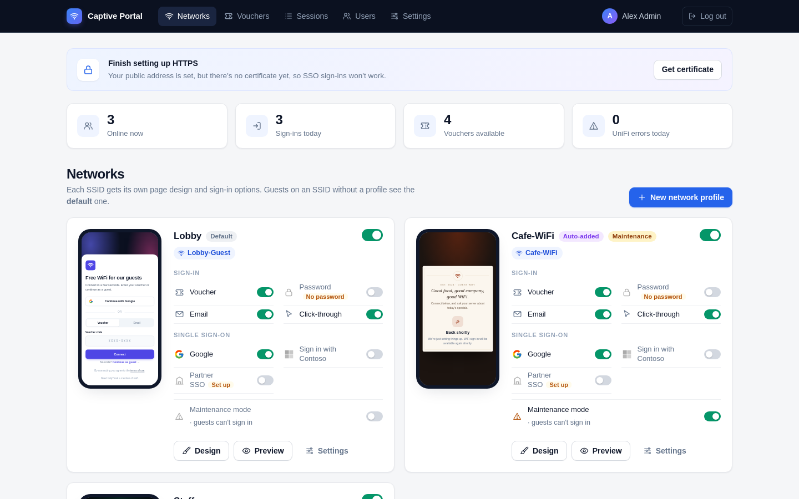

<table>
  <tr>
    <td align="center">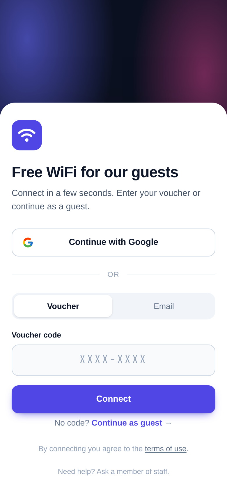<br><sub>Guest network</sub></td>
    <td align="center">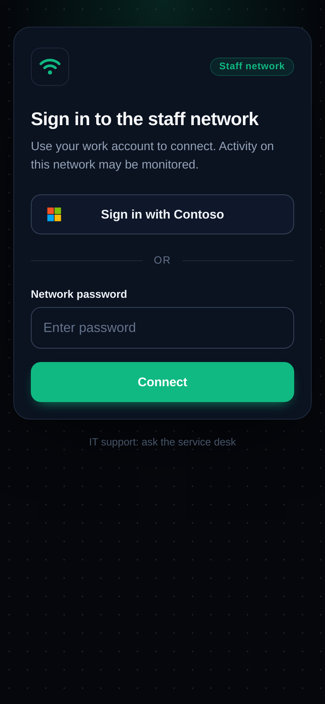<br><sub>Staff network (SSO)</sub></td>
    <td align="center">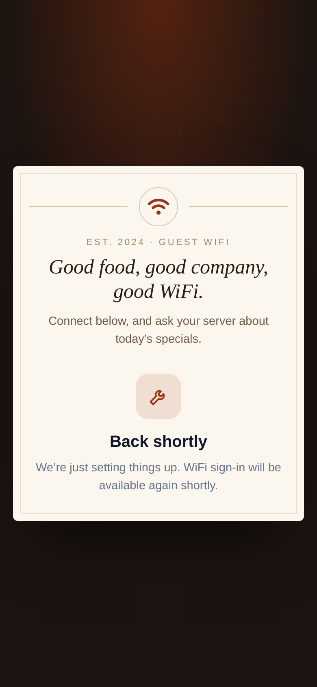<br><sub>Maintenance mode</sub></td>
  </tr>
</table>

---

## Contents

- [Features](#features)
- [Screenshots](#screenshots)
- [Quick start](#quick-start)
- [Connecting UniFi](#connecting-unifi)
- [Networks, sign-in methods and SSO](#networks-sign-in-methods-and-sso)
- [Page designer](#page-designer)
- [HTTPS certificates](#https-certificates)
- [Admin accounts and two-factor sign-in](#admin-accounts-and-two-factor-sign-in)
- [Backup and restore](#backup-and-restore)
- [Security](#security)
- [Configuration reference](#configuration-reference)
- [Project structure](#project-structure)
- [Development and testing](#development-and-testing)
- [Third-party software](#third-party-software)

---

## Features

**Guest sign-in**
- Voucher codes: generate in batches, with duration, devices per voucher, a "use by" date, speed and data caps, printable sheets and CSV export
- Shared password, email registration (with optional marketing opt-in), and click-through
- Single sign-on: **Google, Microsoft / Entra ID, Apple, Facebook, generic OpenID Connect, SAML 2.0**. You can add several of the same type (e.g. two Entra ID tenants), each with its own button and credentials
- Restrict SSO to your email domains, and pin Microsoft to your tenant
- Optional **temporary internet while signing in**, so authenticator-app pushes work on phones (per network)
- Terms of use: "by connecting you agree…" or a tick box

**Per-SSID networks**
- Each SSID gets its own page design, sign-in methods, session length and speed/data limits
- **SSID auto-discovery**: new portal-enabled SSIDs on your controller get a profile automatically
- **Maintenance mode** per network, which blocks sign-in while you set things up

**Page designer**
- Drag-and-drop editor (built on GrapesJS) with simple, plain-English controls
- **14 templates** (hotel, café, restaurant, corporate, events, studio, healthcare, education, retail, gym…)
- Image uploads, a light/dark sign-in box, page fonts and backgrounds, and phone/tablet/desktop preview

**Admin**
- Dashboard with live phone previews of each portal
- Sessions with device names, makers, IP addresses, access point, signal and data used, with one-click disconnect
- Multiple admin accounts, auto-generated passwords, and **two-factor sign-in** (authenticator apps plus recovery codes)
- **HTTPS certificates**: automatic Let's Encrypt via your DNS provider's API (MyDNSHost, Cloudflare, Route 53, Azure DNS, Google Cloud DNS, DigitalOcean, Hetzner, Gandi), a manual DNS record, or upload your own
- **Backup and restore** of everything, with encrypted downloads and daily automatic backups

---

## Screenshots

| | |
|---|---|
| 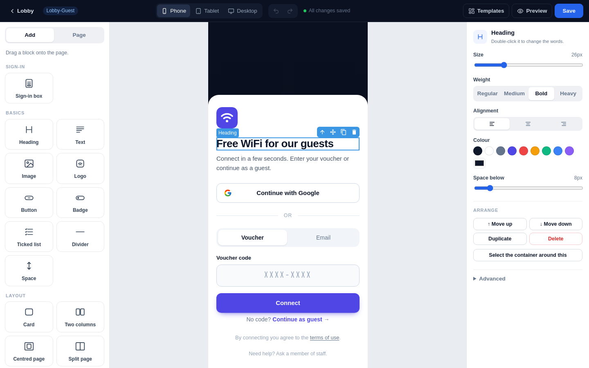 **Page designer**: click anything to edit it | 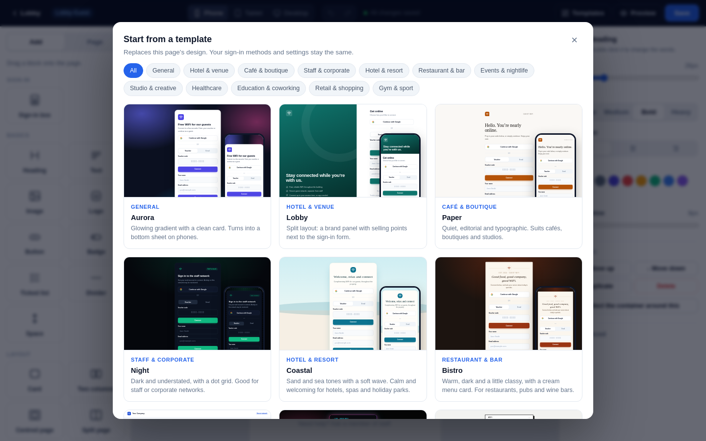 **Templates**: 14 starting points with category filters |
| 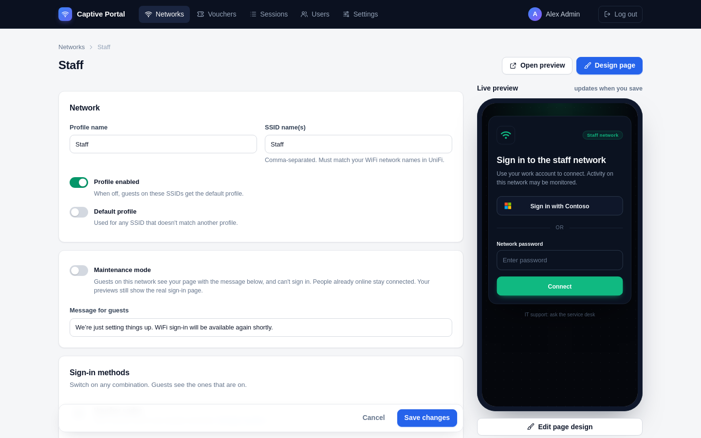 **Network settings** with live preview | 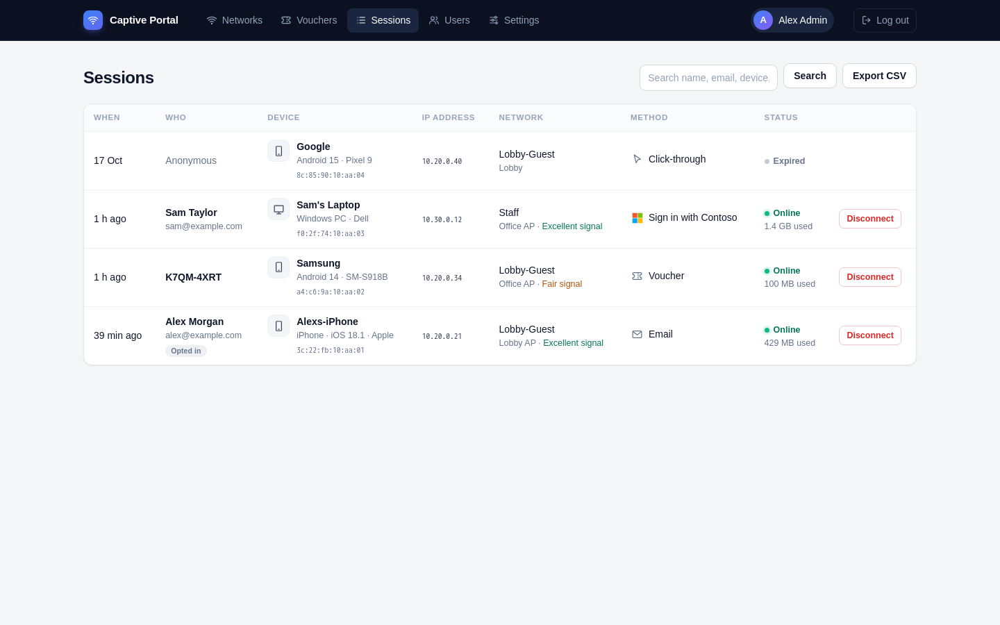 **Sessions** with device details |
| 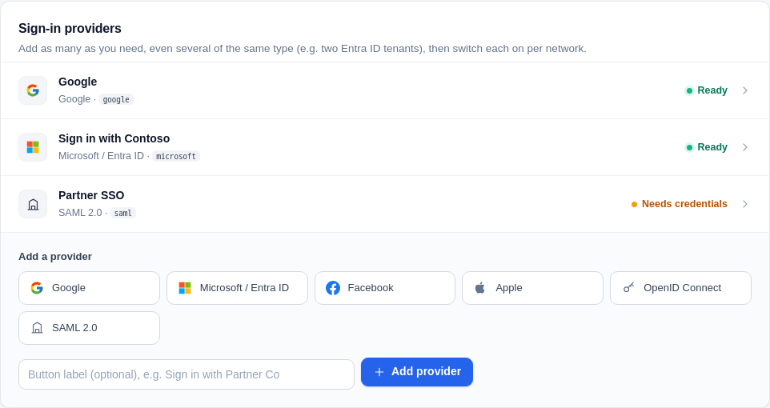 **Sign-in providers** | 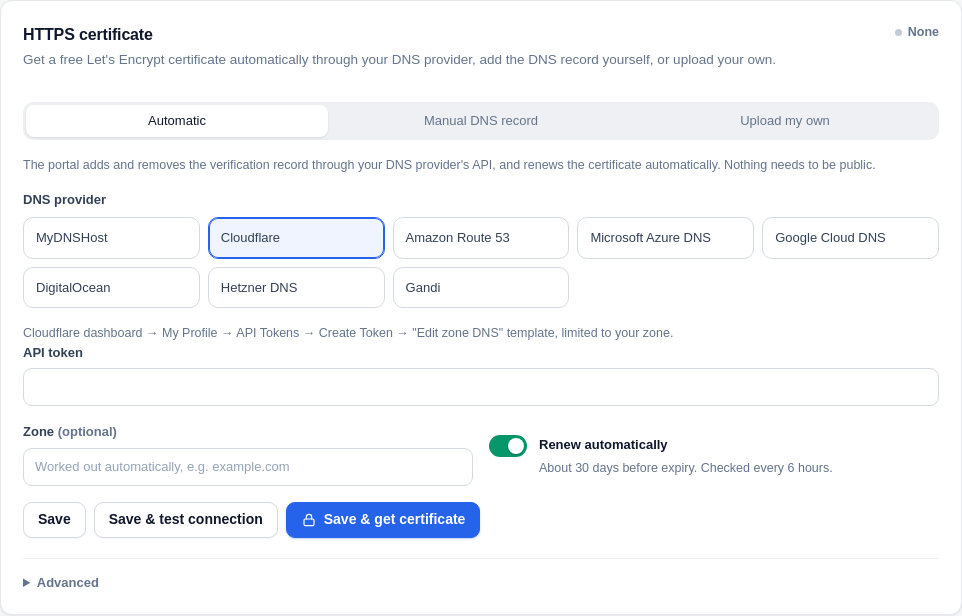 **HTTPS certificate**: automatic, manual or upload |
| 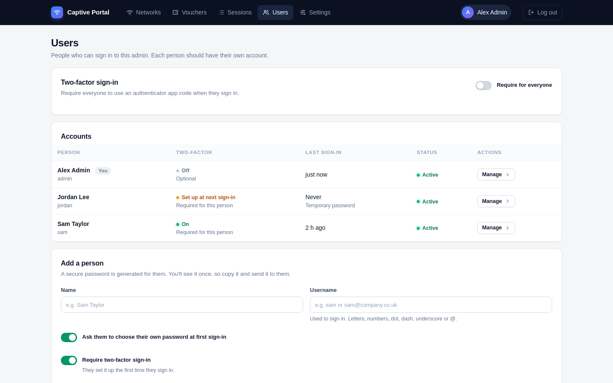 **Users** and two-factor status | 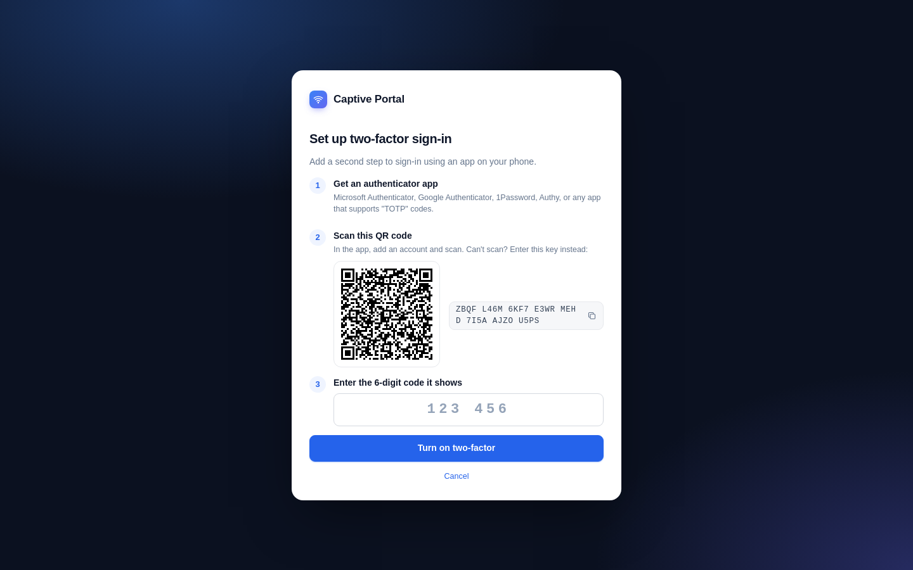 **Two-factor setup** |
| 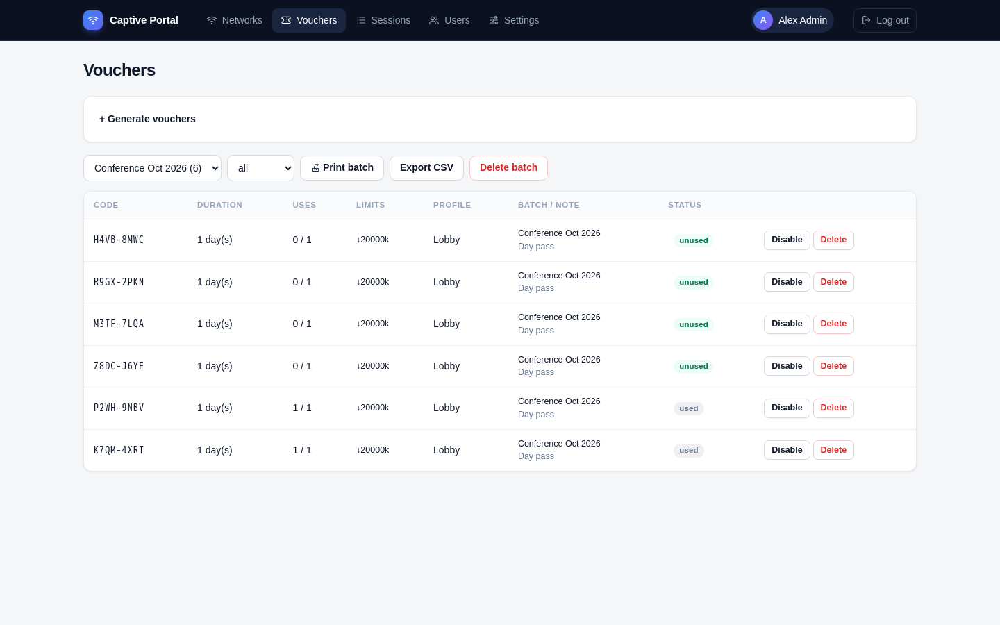 **Vouchers** | 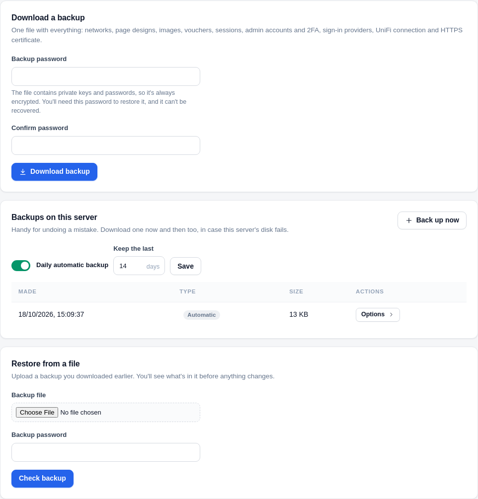 **Backup and restore** |
| 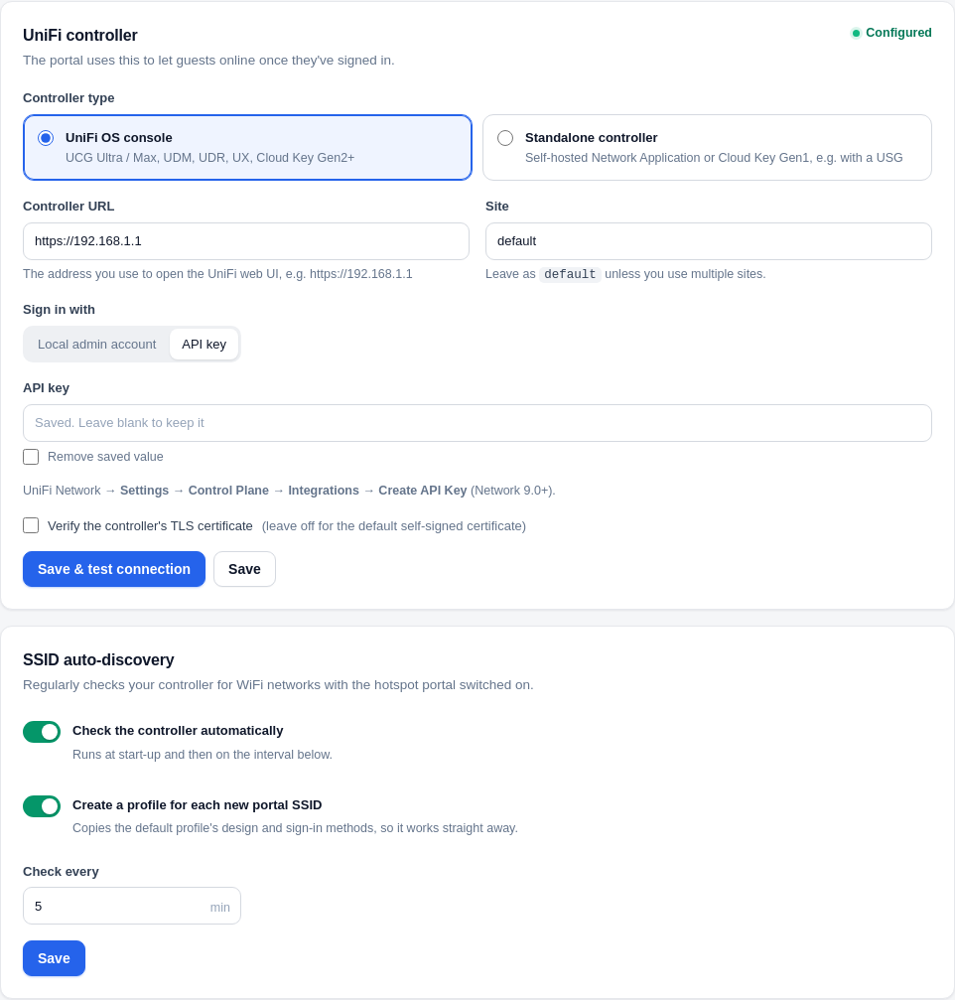 **UniFi controller** connection | 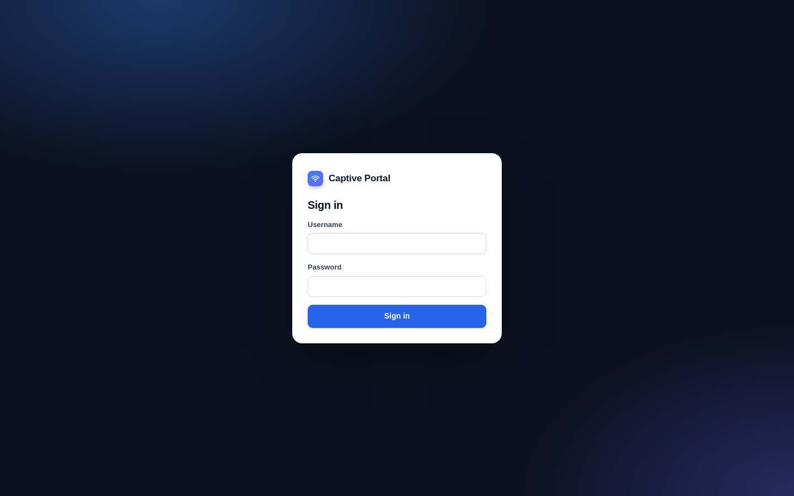 **Admin sign-in** |

---

## Quick start

**Requirements:** a Linux host (VM or LXC is fine) with Docker and Docker Compose, on a network your UniFi gateway can
reach, with ports 80 and 443 free.

```bash
git clone <this repository> captive-portal
cd captive-portal
cp .env.example .env              # set ADMIN_PASSWORD (only used for the first start)
mkdir -p data && sudo chown 1000:1000 data
docker compose up -d --build
```

Open `http://<server-ip>/admin` and sign in as `admin` with the password from `.env`. Then:

1. **My account** (top right): change your password, and set up two-factor sign-in.
2. **Settings → Controller**: connect your UniFi gateway.
3. **Settings → Hotspot setup**: follow the checklist to point UniFi at the portal.
4. **Networks**: adjust each SSID's sign-in options and design its page.

Everything the portal stores (database, uploads, certificates, backups) lives in `./data`.

**Updating:** pull the latest code and run `docker compose up -d --build`. Your data is kept.

---

## Connecting UniFi

### Controller connection (Settings → Controller)

| Controller type | Use for | Sign in with |
|---|---|---|
| **UniFi OS console** | UCG Ultra/Max, UDM, UDR, UX, Cloud Key Gen2+ | A **local admin account**, or an **API key** (UniFi Network → Settings → Control Plane → Integrations, Network 9.0+) |
| **Standalone controller** | Self-hosted Network Application or Cloud Key Gen1 (e.g. with a USG) | A local admin account. The URL includes the port, usually `https://<ip>:8443` |

Click **Save & test connection**. With an API key, the portal uses UniFi's official Integration API and falls back to the
classic API where needed.

### Hotspot settings in UniFi

1. **Settings → WiFi**: edit each guest SSID and turn on **Hotspot Portal**.
2. **Hotspot → Authentication**: choose **External Portal Server** and enter the portal server's IP.
3. Turn **HTTPS redirection / Encrypted redirect URL** off. UniFi always redirects guests to `http://<ip>/guest/s/default/`, and the portal moves them to HTTPS itself.
4. **Pre-Authorization Allowances**: add the portal's IP and hostname, plus the SSO domains listed under **Settings → Hotspot setup** (only for SSO providers you use).
5. Leave **Post-Authorization Restrictions** for blocking your private networks. Don't put the portal there.

The portal confirms each guest with the controller (the device's IP and SSID), so links can't be reused by another device,
and a hand-edited SSID can't pick another network's sign-in page.

---

## Networks, sign-in methods and SSO

Each **network profile** is matched by SSID name. Guests on an SSID without a profile see the **default** profile. With
**SSID auto-discovery** on (Settings → Controller), new portal-enabled SSIDs get a profile copied from the default one.

### Sign-in methods

| Method | Notes |
|---|---|
| **Voucher** | Duration counts from first use. Codes avoid look-alike characters. Batches can be printed or exported |
| **Shared password** | One password per network |
| **Email registration** | Optional name field and marketing opt-in. Entries appear in Sessions and the CSV export |
| **Click-through** | Shown as a "Continue as guest" link when other methods are available |
| **SSO** | Google, Microsoft / Entra ID, Apple, Facebook, OpenID Connect, SAML 2.0 |

### Single sign-on

Add providers under **Settings → Sign-in providers** (you can add several of each type), then switch them on per network.
Each provider shows its own callback URL with a copy button.

- **Restrict to email domains** (per network): e.g. only `example.com` accounts on a staff network.
- **Microsoft:** multi-tenant sign-ins let any organisation set its users' email addresses, so domain rules are only enforced when the provider is **pinned to your tenant** (Tenant = your tenant ID, or Allowed tenant IDs). The UI warns you when it isn't.
- **HTTPS is required** for every SSO provider. See [HTTPS certificates](#https-certificates).

> **Phones' captive pop-up.** iOS and Android open the portal in a cut-down browser. Microsoft, Apple, OIDC and SAML
> generally work there. **Google blocks sign-in inside embedded browsers** (`disallowed_useragent`), and Facebook sometimes
> does the same.

### Temporary internet while signing in

When people approve a sign-in in an authenticator app, the phone closes the captive pop-up, and the push can't arrive
without internet. Turn on **Temporary internet while signing in** for a network to fix this:

- When a guest starts SSO, their device gets a few minutes of capped access (default 5 min at 2 Mbps).
- If the pop-up closes, they open Safari or Chrome, go to the portal address (or `/continue`), and tap **Continue**.
- On success they get the normal session. A refused account has the temporary access removed immediately. Otherwise it simply expires.
- Each device can only get one grace period per cooldown (default 60 min).

### Maintenance mode

Each network has a **Maintenance mode** switch (on its dashboard card or in its settings). Guests see the page with a
short message instead of the sign-in options, and sign-in is blocked on the server. People already online stay connected,
and admin previews still show the real page.

---

## Page designer


- **Add**: drag blocks onto the page: sign-in box, heading, text, image, logo, button, badge, ticked list, divider, space, card, columns, centred and split layouts, and footer.
- **Page**: background presets, colour or photo; font style; the sign-in box's button colour and light/dark style.
- **Edit**: click anything for simple controls (size, weight, alignment, colour, spacing, corners, shadow, links, and image upload or replacement), plus move up/down, duplicate and delete.
- **Templates**: 14 designs with category filters. Applying one replaces the design but keeps the sign-in settings.
- **Advanced**: the full GrapesJS style manager, layers, code view and HTML import.

The **Sign-in box** block shows the real sign-in widget for that network, so what you see is what guests get. Uploaded
images are served by the portal, so they load before guests are online. Avoid external fonts and images.

---

## HTTPS certificates

SSO providers only accept `https://` callbacks, so the portal needs a hostname and a trusted certificate. **It can be
internal-only**: no public DNS record or port forwarding is needed.

1. Add a **local DNS record** on your gateway for the hostname (e.g. `wifi.example.com`) pointing at the portal server, and add the hostname to **Pre-Authorization Allowances**.
2. Set it under **Settings → Hotspot setup → Public HTTPS address**.
3. Choose how to get the certificate:

| Option | How | Renewal |
|---|---|---|
| **Automatic** | The portal creates and removes the Let's Encrypt DNS-01 record through your DNS provider's API, with progress shown live | Automatic, about 30 days before expiry (checked every 6 hours; the dashboard warns if it fails) |
| **Manual DNS record** | The page shows the exact TXT record to add, with **Check DNS** against your authoritative nameservers | You repeat the steps (the dashboard reminds you) |
| **Upload my own** | PEM certificate (with chain) and unencrypted key, or `.pfx`/`.p12` with a password. Checked for hostname, key match and dates | Upload a replacement before it expires |

**Supported DNS providers for automatic certificates**

| Provider | Credentials |
|---|---|
| MyDNSHost | A domain key (recommended), or an account API key plus account email |
| Cloudflare | API token with "Edit zone DNS" on the zone |
| Amazon Route 53 | Access key with `route53:ListHostedZonesByName`, `route53:ChangeResourceRecordSets`, `route53:GetChange` |
| Microsoft Azure DNS | App registration (tenant, client ID, secret) with **DNS Zone Contributor** on the zone, plus subscription and resource group |
| Google Cloud DNS | Service account key (JSON) with **DNS Administrator** |
| DigitalOcean | API token with domain read/write |
| Hetzner DNS | API token from dns.hetzner.com (zones moved to the new Hetzner Console aren't supported yet) |
| Gandi | Personal access token with DNS permissions |

New certificates take effect immediately, with no restart. Guests are only moved onto HTTPS while a valid certificate is
installed, so a missing or expired certificate never locks them out.

---

## Admin accounts and two-factor sign-in

- **Users**: one account per person. A strong password is generated and **shown once**, with copy buttons. By default the person chooses their own at first sign-in. **Reset password** works the same way.
- **Two-factor sign-in**: authenticator app codes (Microsoft/Google Authenticator, 1Password, Authy…) and 10 one-time recovery codes. Require it **for everyone** or **per person**. Admins can **reset two-factor** for someone who lost their phone.
- Resets, two-factor changes and disabling an account sign that person out everywhere. You can't delete or disable your own account, or the last active one.

---

## Backup and restore

**Settings → Backup & restore**

- **Download a backup:** one file with everything (networks, designs, images, vouchers, sessions, admin accounts and 2FA, sign-in providers, the UniFi connection and the HTTPS certificate), always **encrypted** (AES-256-GCM, scrypt) with a password you choose.
- **Backups on this server:** daily automatic backups (the last 14 kept by default), plus **Back up now**, stored in `./data/backups`.
- **Restore:** upload a backup or pick a server copy, check the summary, and confirm with your admin password. A safety backup is taken first, then the portal restarts (about 10 seconds).

`.env` isn't included (it only holds first-start defaults). To move servers: copy `docker-compose.yml` and `.env`, start
the portal, and restore a backup.

---

## Security

- **Admin access:** devices on hotspot (guest) SSIDs can't open `/admin`. Optionally allow only specific networks (**Settings → Account → Who can open the admin**). Once a certificate is active, `/admin` always uses HTTPS.
- **Sign-in:** bcrypt password hashes, rate limiting, TOTP with replay protection, and signed session cookies tied to an account version (resets sign people out).
- **Web protections:** CSRF tokens on every admin action, escaped output, frame blocking and other security headers, and a strict content policy on uploaded files.
- **Secrets:** API keys, client secrets and private keys are stored in the database in `./data` and are never shown again in the UI. Backups downloaded from the UI are always encrypted.
- **Locked out of the admin?** Add `ADMIN_ALLOW_ALL=1` to `.env`, run `docker compose up -d`, fix the setting, then remove the line again.

Please report security issues privately rather than in a public issue.

---

## Configuration reference

Most settings live in the admin UI. `.env` holds only these:

| Variable | Purpose |
|---|---|
| `ADMIN_USER`, `ADMIN_PASSWORD` | First admin account, created on first start only |
| `PORTAL_IP` | The portal's LAN IP, shown in the setup checklist (optional) |
| `PUBLIC_URL` | Fallback for the public HTTPS address (normally set in the UI) |
| `ADMIN_ALLOW_ALL=1` | Emergency: let any device open `/admin` |
| `ADMIN_ALLOW_HTTP=1` | Don't redirect `/admin` to HTTPS |
| `TRUST_PROXY=1` | Only if you put your own reverse proxy in front |

Ports: the container serves HTTP on 3000 (published as 80, which UniFi needs) and HTTPS on 3443 (published as 443).

---

## Project structure

```
src/
  server.js        HTTP/HTTPS servers, security headers, schedulers
  portal.js        Guest flow: UniFi redirect, sign-in methods, SSO callbacks, success page
  admin.js         Admin dashboard, settings, users, vouchers, sessions, backups
  unifi.js         UniFi OS / standalone controller client (classic + Integration API)
  sso.js           Google, Microsoft, Apple, Facebook, OIDC (PKCE) and SAML
  tls.js           Let's Encrypt (manual + automatic DNS-01), uploads, renewals
  dnsproviders.js  DNS provider APIs for automatic certificates
  accounts.js      Admin accounts, generated passwords, two-factor
  totp.js          RFC 6238 one-time codes
  backup.js        Encrypted backups and restore
  grace.js         Temporary internet while signing in
  ssidsync.js      SSID auto-discovery
  templates.js     Page templates
views/             EJS templates (admin and guest pages)
public/            Admin, designer and guest scripts and styles; vendor/ holds GrapesJS
docs/screenshots/  Images used in this README
```

Stack: Node.js 22, Express, SQLite (better-sqlite3), EJS, GrapesJS. One container, no external database.

---

## Development and testing

```bash
npm install
DATA_DIR=./data ADMIN_PASSWORD=dev-password node src/server.js   # http://localhost:3000/admin
```

Features were tested against isolated instances with mock services:

- **UniFi:** mock controllers for UniFi OS (credentials and API key) and standalone controllers.
- **SSO:** mock OIDC provider round trips, plus request construction for each provider.
- **Certificates:** end to end against Let's Encrypt's test CA ([Pebble](https://github.com/letsencrypt/pebble)) and its test DNS server. Automatic issue and renewal were tested with Cloudflare and MyDNSHost API mocks. Route 53 signing matches AWS's published SigV4 test vectors.
- **Browser flows:** Playwright (designer, templates, guest pages, 2FA, uploads).

The Route 53, Azure DNS, Google Cloud DNS, DigitalOcean, Hetzner and Gandi integrations were checked for correct
requests against mocks, but haven't been run against real accounts. Use **Save & test connection** first, and please open
an issue if one misbehaves.

Testing overrides: `ACME_DIRECTORY_URL`, `ACME_DNS_CHECK_SERVERS`, `ACME_DNS_WAIT_MS`, `ACME_DNS_POLL_MS` and
`DNS_API_<PROVIDER>` (e.g. `DNS_API_CLOUDFLARE`) point the portal at test servers.

---

## Third-party software

Built with Express, EJS, better-sqlite3, bcryptjs, multer, @node-saml/node-saml, acme-client, qrcode and node-forge
(installed from npm at build time), and bundles **GrapesJS** (BSD-3-Clause) and **grapesjs-style-bg** (MIT). See
[THIRD_PARTY_NOTICES.md](THIRD_PARTY_NOTICES.md).

UniFi is a trademark of Ubiquiti Inc. This project isn't affiliated with or endorsed by Ubiquiti. Provider names and logos
belong to their respective owners.

## Licence

Released under the [MIT License](LICENSE). Copyright (c) 2026 MonkeyCode.

Bundled third-party components keep their own licences. See [THIRD_PARTY_NOTICES.md](THIRD_PARTY_NOTICES.md).
